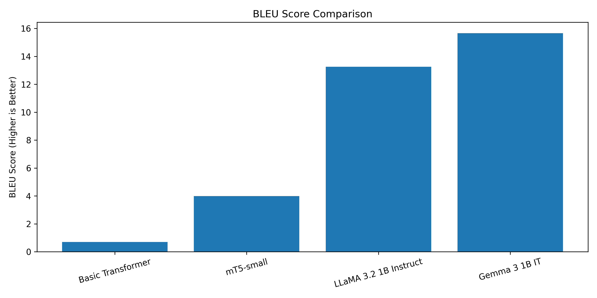
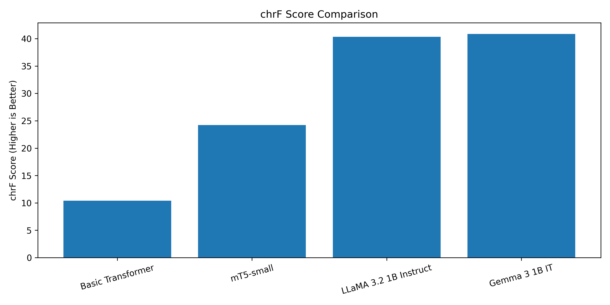
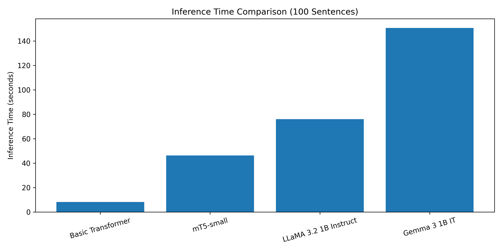

# Neural Machine Translation: Transformer vs mT5 vs LLaMA vs Gemma

**Foundations of Generative AI (ICT4403) — Assignment 3**

## 1. Project Overview

This project implements and compares four neural machine translation systems for English-to-French translation:

- Basic Transformer (encoder–decoder)
- mT5-small (encoder–decoder)
- LLaMA 3.2 1B Instruct (decoder-only)
- Gemma 3 1B IT (decoder-only)

The objective is to compare translation quality, computational requirements, and architectural differences using BLEU, chrF, inference time, model parameter counts, and qualitative analysis.

## 2. Dataset

**Dataset:** OPUS Books — English–French Parallel Corpus

**Source:** https://huggingface.co/datasets/Helsinki-NLP/opus_books

The original dataset contained 127,085 English–French translation pairs.

### Preprocessing

1. Removed duplicate sentence pairs, leaving 126,441 unique pairs.
2. Filtered sentence pairs to retain 3–30 words in both languages, leaving 93,206 pairs.
3. Randomly selected 10,000 pairs using `random_state=42`.
4. Split the dataset using grouped sampling to prevent identical normalized English source sentences from appearing in multiple splits.

| Split | Sentence Pairs |
|---|---:|
| Training | 7,999 |
| Validation | 1,000 |
| Testing | 1,001 |

A fixed subset of 100 held-out test sentences was used for the final evaluation of all four models.

## 3. Models and Methodology

### Basic Transformer

Implemented a Transformer encoder–decoder using PyTorch with:

- Embedding dimension: 128
- Attention heads: 4
- Encoder layers: 2
- Decoder layers: 2
- Feed-forward dimension: 512
- Vocabulary size: 8,000 tokens per language
- Maximum sequence length: 40 tokens

The model was trained from scratch for 10 epochs using teacher forcing, Adam optimization, cross-entropy loss, and validation monitoring.

### mT5-small

Fine-tuned the pretrained multilingual encoder–decoder model `google/mt5-small`.

- Fine-tuning examples: 2,000
- Validation examples: 200
- Fine-tuning epochs: 1
- Batch size: 4
- Learning rate: 0.0003

### LLaMA 3.2 1B Instruct

Evaluated `meta-llama/Llama-3.2-1B-Instruct` using zero-shot instruction prompting with 4-bit quantization.

No task-specific fine-tuning was performed.

### Gemma 3 1B IT

Evaluated `google/gemma-3-1b-it` using zero-shot instruction prompting with 4-bit quantization.

No task-specific fine-tuning was performed.

## 4. Experimental Results

| Model | BLEU ↑ | chrF ↑ | Training Time (s) | Inference Time (s) |
|---|---:|---:|---:|---:|
| Basic Transformer | 0.7059 | 10.3877 | 50.99 | 8.19 |
| mT5-small | 3.9855 | 24.2093 | 121.14 | 46.34 |
| LLaMA 3.2 1B | 13.2567 | 40.3171 | N/A | 76.11 |
| **Gemma 3 1B** | **15.6651** | **40.8492** | N/A | 150.72 |

Inference times were measured over 100 held-out English sentences. LLaMA and Gemma were evaluated without task-specific training.

### Parameter Counts

| Model | Reported Parameters |
|---|---:|
| Basic Transformer | 4,006,208 |
| mT5-small | 300,176,768 |
| LLaMA 3.2 1B | 749,275,136 |
| Gemma 3 1B | 651,005,056 |

The LLaMA and Gemma values were obtained from the loaded 4-bit quantized models. They should not be interpreted as the original published parameter counts, since quantization can alter how parameter storage is represented.

## 5. Model Comparison

The Basic Transformer had the shortest inference time but the lowest translation quality. Its limited training corpus and word-level vocabulary contributed to frequent unknown-token predictions.

mT5-small improved on the Basic Transformer, benefiting from multilingual pretraining, although it was fine-tuned for only one epoch on a small subset.

LLaMA and Gemma generated more fluent French translations using instruction prompting, despite receiving no task-specific fine-tuning.

Gemma achieved the highest BLEU and chrF scores but required the longest inference time.

Differences in pretraining, tokenization, model size, adaptation method, and quantization limit direct architectural conclusions.

## 6. Evaluation Visualizations

### BLEU Comparison

### chrF Comparison

### Inference Time Comparison

## 7. Decoding and Sampling Temperature

The main evaluation used deterministic greedy decoding (`do_sample=False`) to maintain consistent decoding settings across models.

Sampling temperature controls the randomness of token selection when sampling is enabled:

- **0.5:** Favors high-probability tokens.
- **1.0:** Samples from the original probability distribution.
- **1.5:** Increases the probability of less likely tokens.

Higher temperatures may increase lexical variation but can reduce translation faithfulness.

No separate temperature-sampling experiment was conducted in the reported results. Therefore, the temperature discussion is theoretical rather than an empirical comparison.

## 8. Responsible and Ethical AI

### Bias

Machine translation systems may reproduce gender stereotypes and cultural biases present in their training data.

**Mitigation:** Evaluate on diverse examples and incorporate human review.

### Hallucination and Meaning Distortion

Models may introduce information absent from the source text, omit details, or change the intended meaning.

**Mitigation:** Apply source-faithfulness checks and human verification for important translations.

### Cultural Misrepresentation

Idioms, historical references, and literary expressions may not have direct equivalents in another language.

**Mitigation:** Use culturally diverse datasets and native-speaker evaluation.

### Sensitive Content

Incorrect translations of medical, legal, or financial information can have serious consequences.

**Mitigation:** Use qualified human translators and domain-specific quality assurance for high-stakes content.

## 9. Installation and Execution

The project was developed using Python, PyTorch, Hugging Face Transformers, and Kaggle Notebooks with NVIDIA T4 GPUs.

### Main Dependencies

- torch
- transformers
- datasets
- accelerate
- bitsandbytes
- sentencepiece
- sacrebleu
- pandas
- numpy
- matplotlib
- scikit-learn
- huggingface-hub

### Execution Steps

1. Open `FGAI_Assignment3_Machine_Translation.ipynb` in Kaggle.
2. Enable GPU acceleration and internet access.
3. Install the required dependencies.
4. Download and preprocess the OPUS Books dataset.
5. Train the Basic Transformer.
6. Fine-tune mT5-small.
7. Authenticate with Hugging Face to access gated LLaMA and Gemma checkpoints.
8. Generate translations on the fixed evaluation subset.
9. Calculate BLEU, chrF, inference time, and parameter counts.
10. Generate comparison plots and review the qualitative results.

Some pretrained models require accepting their respective model licenses.

## 10. Results and Project Files

The `results/` directory contains:

- Model evaluation metrics
- Generated English-to-French translations
- Final comparison table
- Training history
- BLEU, chrF, and inference-time graphs
- Fixed evaluation subset

Large model checkpoints are not included in the GitHub repository.

## 11. Conclusion

Gemma 3 1B IT achieved the best translation quality in this experiment, with BLEU 15.6651 and chrF 40.8492.

LLaMA 3.2 1B Instruct was the second-best model, while the Basic Transformer had the fastest inference time.

The findings highlight the benefits of pretrained language models for translation under the tested conditions, while also demonstrating trade-offs in inference cost, model size, and translation quality.

These results are specific to the chosen dataset subset, prompting strategies, and computational environment.
